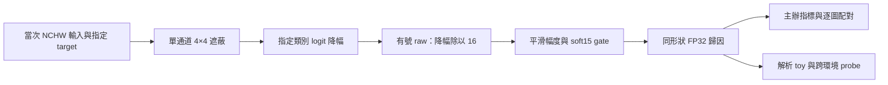

# ShieldCup Ship XAI

**船舶影像可解釋 AI：配對實驗、獨立解釋器、容器交付與驗收工具。**

Explainability experiments and deployment engineering for a fixed ResNet50 ship classifier, developed for the 2026 Shield Cup. A synthetic demo runs without competition data or weights.

本專案研究輸入特徵如何影響模型對指定船舶類別的分數，並將 Mac 研究程式整理成可驗證的 Linux 交付環境。內容包含候選失敗紀錄、兩個評估種子的配對確認、來源追溯、CPU Docker 封裝，以及團隊提交包的獨立驗收。

## 專案成果

| 項目 | 已完成成果 | 程式／證據 |
|---|---|---|
| XAI 實作 | 單通道 4×4 有號遮蔽＋soft15；指定 target、FP32、同形狀輸出 | [解釋器](runtime/src/explainer.py) |
| 配對研究 | 同九圖、兩個 seed，各對各自 8×8 對照均為 9/9 改善 | [Stage25](docs/stage25/report.md)、[Stage26](docs/stage26/report.md) |
| 交付工程 | ARM64／AMD64 CPU 容器、固定相依、save／load／smoke、checksum | [部署驗收](docs/deployment/README.md) |
| 數值契約 | 解析 toy 確認 supplied target、正負歸因、輸入／RNG 不變 | [示範](runtime/quick_demo.py) |
| 品質驗收 | CSV、manifest、Docker／OCI layer 與合成邊界案例 | [驗收工具](tools/jetson_audit/README.md) |
| 技術溝通 | 團隊研究方法、定稿檢核、口述稿整理 | [研究案例](docs/publication/README.md) |

### 保存的九圖配對結果

| Mac MPS FP32／seed | 8×8 對照 | 4×4 soft15 | 分數差 | 改善張數 |
|---|---:|---:|---:|---:|
| 42 | 78.621952 | 82.653706 | +4.031754 | 9/9 |
| 314159 | 77.155063 | 82.761703 | +5.606641 | 9/9 |

分數由主辦評分邏輯與保存的 CSV 得出，來自同九張影像；變更 seed 沒有增加新影像，結果不能外推為隱藏集或泛化表現。2×2 的 85.639166 只來自 Id1 單圖，未完成九圖。新 CPU 容器沒有完整九圖複評，CUDA／Jetson GPU 尚未實測，沒有宣稱正式競賽排名。

## 快速執行

使用 Python 3.12，從倉庫根目錄執行。以下為 CPU 合成示範環境；完整競賽 Docker 環境有獨立的固定相依。

```bash
python3 -m venv .venv
source .venv/bin/activate
python -m pip install torch==2.10.0 --index-url https://download.pytorch.org/whl/cpu
python -m pip install -r requirements-demo.txt
python runtime/quick_demo.py
python tools/jetson_audit/test_tools.py -v
```

示範使用兩個固定 3×8×8 輸入與線性模型，指定 target 刻意不同於 argmax。成功時輸出 `PASS`，驗證解析 raw 歸因、FP32 形狀、正負號及輸入／隨機狀態不變。驗收工具測試以暫存合成 package／image 檢查 CSV、manifest、layer whiteout、hardlink 和 digest；皆不需要官方素材或 GPU。

完整九圖重跑與 CPU Docker 重建須自行提供合法取得的主辦權重、wheel、scorer 與資料，詳見 [runtime 操作說明](runtime/README.md)。

## 方法與工程流程



對 3×224×224 輸入，每次解釋有 9,408 個非重疊 masks，固定每批 64。黑色基準採當次完整輸入最小值，raw 保留正負號。tile 是多元素共同干預，分配回各元素不代表每個元素的精確個別因果效果。

獨立 runner 核對來源 identity，拒絕覆寫 CSV，以唯讀方式掛載輸入，保留失敗證據；有界快取識別當次 input、target、model state 與方法設定，沒有歷史歸因答案依賴。

## 閱讀導覽

- [求職專案說明](docs/portfolio.md)：工程重點、展示順序與履歷敘述。
- [Stage23](docs/stage23/report.md)、[Stage24](docs/stage24/report.md)：RISE／梯度候選及未通過門檻的結果。
- [Stage25](docs/stage25/report.md)、[Stage26](docs/stage26/report.md)：4×4 選擇、第二 seed 確認、2×2 單圖限制。
- [CPU 部署](docs/deployment/README.md)：實際 save／load／smoke 與小型官方模型 probe。
- [提交包驗收](docs/jetson_audit/README.md)：Max_Sensitivity 契約修正案例及靜態檢查限制。
- [團隊發表](docs/publication/case-study.md)：E017 投稿方法、共同作者與報告準備。

## 結構與來源

```text
runtime/                 獨立 4×4 部署程式、CPU Docker 配方、合成示範
tools/jetson_audit/      可重用的 package／image／CSV 驗收工具
experiments/stage23–26/   歷史程式快照、CSV／JSON、逐檔來源紀錄
docs/                    實驗報告、部署證據、研究與發表摘要
src/                     第 22 階段研究基準
.github/workflows/       不依賴官方素材的 CI 檢查
```

`experiments/*/src` 為保留原始位元組的歷史快照，部分依賴原工作樹與未公開素材；可直接執行入口是 `runtime/` 與 `tools/jetson_audit/`。來源紀錄保存原件與整理後副本的 hash，匿名化 JSON 不冒充歷史原件。

本倉庫保存 Mac 端研究、4×4 實作與交付、獨立驗收和團隊文件整理工作；程式與文件開發使用 Codex 協作。E017 解釋算法／runner 由隊友提供，論文為團隊共同成果，詳見 [署名與來源](docs/publication/README.md)。主辦提供的 ResNet50、權重、評分套件與資料不屬於自行訓練或開發的成果。

官方權重、wheel、原始 scorer、競賽影像、含聯絡資料的 Office 原稿、大型 tar／7z／快取保留於本機或外部備份。倉庫保存可展示的自有程式、研究摘要與小型證據。
