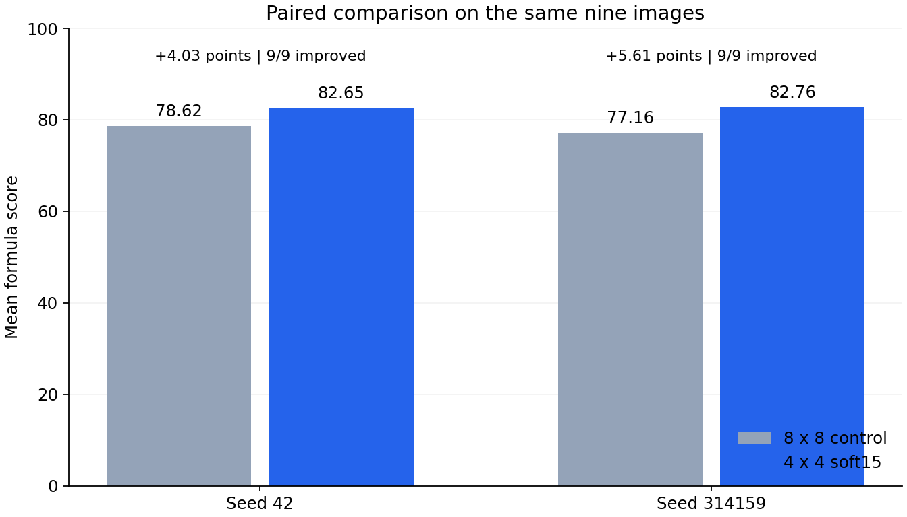
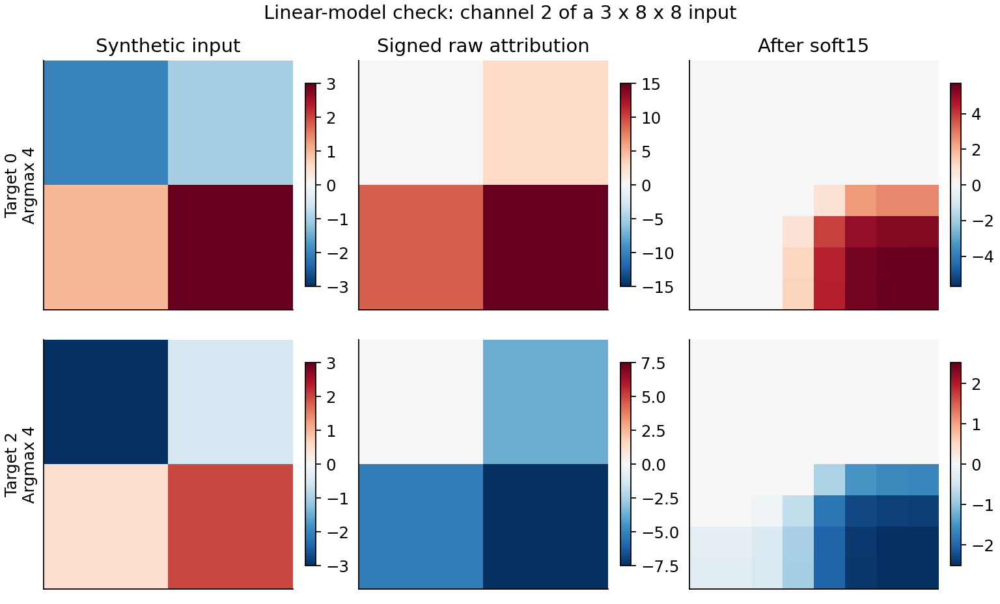
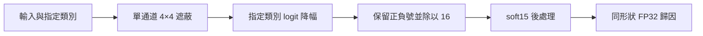

# ShieldCup Ship XAI

[](https://github.com/Owen-Xie1995/ShieldCup-Ship-XAI/actions/workflows/portfolio-checks.yml)

船舶影像可解釋 AI 競賽專案，於比賽結束後整理為公開作品集。沿用主辦提供的 ResNet50，實作並比較影像歸因方法，再把研究程式整理成可驗證的 CPU Docker 交付環境。

主要工作是 **4×4 有號遮蔽、配對實驗、部署與提交包驗收**。E017 團隊投稿算法與 runner 由隊友提供，分類模型與權重由主辦提供；兩條方法的來源與結果分開記錄。

[面試展示指南](docs/interview.md) · [工作範圍與履歷描述](docs/portfolio.md) · [獨立解釋器](runtime/src/explainer.py)

## 實驗結果

單通道 4×4 遮蔽搭配 soft15 後處理，在保存的兩組 Mac MPS 配對實驗中，分別比 8×8 對照高出 4.03 與 5.61 分。



| 評估 seed | 8×8 對照 | 4×4 soft15 | 分數差 | 改善張數 |
|---|---:|---:|---:|---:|
| 42 | 78.621952 | 82.653706 | +4.031754 | 9/9 |
| 314159 | 77.155063 | 82.761703 | +5.606641 | 9/9 |

兩組使用相同九張影像；換 seed 沒有增加樣本，不能據此宣稱隱藏集或新影像表現。這是 **4×4＋soft15 整體方案**相對對照的結果，不能把全部增益歸因於區塊大小。逐圖資料見 [Stage25](docs/stage25/report.md)、[Stage26](docs/stage26/report.md)。2×2 方法只完成一張影像，未完成九圖評估。

## 執行示範

需要 Python 3.12。以下使用合成資料與固定線性模型，不需要競賽影像、官方權重或 GPU。面試前先裝好環境：

```bash
git clone https://github.com/Owen-Xie1995/ShieldCup-Ship-XAI.git
cd ShieldCup-Ship-XAI
python3 -m venv .venv
source .venv/bin/activate

# macOS
python -m pip install torch==2.10.0
# Linux 若只需要 CPU，改用：
# python -m pip install torch==2.10.0 --index-url https://download.pytorch.org/whl/cpu

python -m pip install -r requirements-demo.txt
```

現場執行：

```bash
python tools/interview_demo.py
```

程式先執行 CPU 合成測試，檢查指定類別、解析歸因、正負號、FP32 形狀與輸入／亂數狀態，再從保存 CSV 重算上面的兩組分數。輸出會將「本次合成測試」與「歷史 Mac MPS 結果」分開；這不會重新產生官方九圖評分。需要完整報告時加上 `--json`。



這張圖顯示兩個合成輸入的第三通道（索引 2），不是船舶影像。指定類別為 0、2，模型最高分類別為 4，用來檢查解釋器是否遵守呼叫者指定的目標。其他檢查與圖表重建：

```bash
python tools/jetson_audit/test_tools.py -v
python tools/check_source_syntax.py

# 需要重建圖表時
python -m pip install -r requirements-figures.txt
python tools/build_demo_assets.py
```

## 程式與文件

| 要看什麼 | 入口 |
|---|---|
| 約四分鐘的帶看流程與問答 | [面試展示指南](docs/interview.md) |
| 4×4 遮蔽與 soft15 實作 | [runtime/src/explainer.py](runtime/src/explainer.py) |
| 使用自己的模型與輸入 | [runtime/README.md](runtime/README.md) |
| Docker 建置、執行與歷史驗證紀錄 | [部署說明](docs/deployment/README.md) |
| CSV、manifest 與 Docker／OCI 映像檢查 | [驗收工具](tools/jetson_audit/README.md) |
| RISE 與梯度候選的失敗紀錄 | [Stage23](docs/stage23/report.md)、[Stage24](docs/stage24/report.md) |
| 方法取捨與展示順序 | [專案說明](docs/portfolio.md) |
| E017 團隊投稿與分工 | [研究案例](docs/publication/case-study.md)、[署名與來源](docs/publication/README.md) |

對 3×224×224 輸入，共有 9,408 個遮蔽區塊，每批 64 個。每張圖以完整 CHW 的最小值作基準；遮蔽後的 logit 降幅平均分給區塊內 16 個元素，不能視為逐元素的獨立因果效果。soft15 對各通道分別做空間平滑，再以該張圖完整 CHW 的 85% 分位數作共同門檻，保留原有正負號。



`runtime/` 是目前可執行的獨立版本。`experiments/*/src` 與 `src/` 保存歷史研究程式，部分仍依賴原工作目錄和未公開素材。runner 會核對來源、保護既有輸出，並保留失敗紀錄。

## 驗證範圍與來源

已保存 Linux ARM64／AMD64 CPU 的建置、save／load／smoke 紀錄；CPU 容器尚未完成九圖複評，CUDA／Jetson GPU 尚未實測。CI 執行合成數值、檔案格式與映像檢查測試，不執行官方九圖評分。

本倉庫記錄 Mac 端研究、4×4 解釋器、CPU 部署、提交包驗收與團隊文件整理；開發過程使用 Codex 協作。E017 投稿算法與 runner 由隊友提供，論文是共同成果。正式競賽排名不在此處的驗證範圍內。

官方影像、權重、wheel、原始 scorer、含聯絡資料的文件與大型交付檔保留在本機或外部備份。完整環境的準備方式見 [runtime 操作說明](runtime/README.md)。
